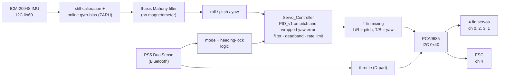
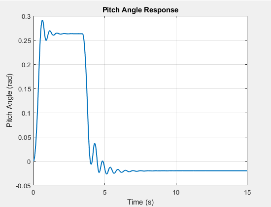

# Underwater Rocket - ESP32 Attitude-Control Firmware (C++)

Embedded C++ firmware (Arduino framework, PlatformIO) for an ESP32-controlled, fin-stabilised underwater vehicle: IMU acquisition and calibration, a 6-axis Mahony attitude filter, pitch/yaw fin control, four-fin servo mixing over a PCA9685, ESC throttle control, Bluetooth (PS5 DualSense) operator control, and over-the-air updates. The repository also contains the MATLAB/Simulink model from the related university graduation project and documents what was and was not demonstrated.

> **Status: prototype / portfolio repository.** No automated tests, no logged flight or pool data, no licence selected yet (see [Licensing](#licensing)). The firmware has known safety limitations - read [docs/SAFETY.md](docs/SAFETY.md) before running anything with a motor attached.

## What is in here

| Directory | What it is | Status |
|---|---|---|
| [`firmware/graduation_aug26_ps5_heading_hold/`](firmware/graduation_aug26_ps5_heading_hold/) | **Aug 26 2025 graduation-project firmware**: PS5 throttle, heading lock, manual fin control, IMU heading hold | Historical variant, **reconstructed build** ([details](firmware/graduation_aug26_ps5_heading_hold/RECONSTRUCTION.md)). Used in the graduation pool tests. **Not** the competition firmware |
| [`firmware/2025_teknofest_mission/`](firmware/2025_teknofest_mission/) | 2025 TEKNOFEST generation: same estimator/controller lineage plus an 8-state mission machine and roll-safety code | Competition-used *generation*; the exact flashed file is not identified. Compiles |
| [`firmware/2026_wifi_control/`](firmware/2026_wifi_control/) | 2026 stabilise-only firmware with browser control page and link-loss fail-safe | Experimental; the planned autonomous mission was **never completed** |
| [`simulation/graduation_2025/`](simulation/graduation_2025/) | MATLAB/Simulink pitch/yaw/depth model with discrete PID controllers | Simulation only; **not** connected to the firmware |
| [`prototypes/`](prototypes/) | Early WebSocket PID-tuning prototype | Secondary; not compiled in this repo's CI |
| [`docs/`](docs/) | Architecture, safety, development history, graduation project, licensing | |

## Architecture at a glance



Full diagrams (runtime tasks, PS5 command map, actuator and ESC wiring) are in [docs/ARCHITECTURE.md](docs/ARCHITECTURE.md).

### Implemented behaviour (Aug 26 variant)

- **Estimation:** startup still-calibration (500 samples), online gyro-bias adaptation when the vehicle is provably still, 8-sample moving average on gyro-z, hand-written 6-axis Mahony update (standard algorithm; see [docs/LICENSING.md](docs/LICENSING.md) for provenance), quaternion to roll/pitch/yaw. Yaw is gyro-integrated, so the locked heading is relative and drifts.
- **Control:** pitch and yaw controllers built on `PID_v1` (P-only in the preserved configuration), wrapped yaw error, circular yaw filter, deadband, per-fin rate limiting, differential four-fin mixing.
- **Heading lock:** captures the current yaw as the reference, either on a Triangle press or automatically once throttle has stayed above 1200 us for 300 ms; the controller then drives the top/bottom fins differentially to return toward that heading.
- **Operator interface:** PS5 DualSense over Bluetooth - throttle in 100 us steps, Auto/Manual chords, kill button, stick-driven manual fins.
- **Robustness:** I2C bus-clear recovery, IMU soft-reset watchdog, clamped `dt`; OTA update task pinned to core 0.

Parameters of the preserved configuration are listed in [docs/ARCHITECTURE.md](docs/ARCHITECTURE.md#implemented-parameters).

## Graduation-project evidence (qualitative)

The Aug 26 firmware was used on a physical vehicle in university pool tests. The operator used the PS5 controller for **throttle and heading lock**. In the heading-correction test the vehicle was aligned, heading lock was activated, and the orientation was then deliberately disturbed to observe whether the IMU-based controller would return it toward the locked heading through differential fin actuation.

**What this demonstrates:** the closed-loop heading-hold mechanism exists in the firmware and was exercised on hardware, with qualitative observation of the vehicle's path (camera and stopwatch).

**What it does not demonstrate:** no IMU or fin-command logs were recorded, so there are **no yaw-error, settling-time, overshoot or repeatability figures**, no lock-off baseline, and no claim about performance across speeds. The tests were operator-throttled; the system was **not autonomous**. Details: [docs/GRADUATION_PROJECT.md](docs/GRADUATION_PROJECT.md).

### Simulation (separate from the firmware)

The graduation work also includes a Simulink model with discrete PID controllers for pitch, yaw and depth (via pitch). These are **simulation-only**; the embedded firmware uses different parameters, units, limits and update rate and has no depth loop (the vehicle had no pressure sensor).

| Depth response (sim) | Pitch response (sim) | Yaw response (sim) |
|---|---|---|
|  |  |  |

## Build

Prerequisites: [PlatformIO Core](https://platformio.org/) 6.x and internet access (libraries are fetched; nothing third-party is vendored).

```bash
cd firmware/graduation_aug26_ps5_heading_hold      # or 2025_teknofest_mission / 2026_wifi_control
cp include/secrets.h.example include/secrets.h     # set your own AP/OTA password and PS5 pairing address
pio run -e esp32-usb
```

- Platform (`espressif32@6.6.0`), framework and every library are pinned; the SparkFun IMU driver and the PS5 library are pinned to commit hashes.
- The PS5 library is **fetched at build time and not redistributed here**: its upstream repository has no licence file ([docs/LICENSING.md](docs/LICENSING.md)).
- CI compiles all three firmware variants on every push ([.github/workflows/build.yml](.github/workflows/build.yml)). Compiling is the only thing verified; **nothing here has been re-run on hardware from this repository.**
- On Windows keep the checkout path short; the SparkFun library can exceed the 260-character path limit.
- OTA upload: set `UWR_OTA_PASSWORD` in your environment and use `-e esp32-ota`.
- Real credentials and the controller pairing address live only in the git-ignored `include/secrets.h`. They were removed from the historical sources; see [RECONSTRUCTION.md](firmware/graduation_aug26_ps5_heading_hold/RECONSTRUCTION.md) for the exact (two-line) sanitisation.

## Known limitations (summary)

Verified in the source; full list in [docs/SAFETY.md](docs/SAFETY.md):

1. After the PS5 kill button is pressed the **ESC keeps receiving the last throttle command** (only the fins are neutralised).
2. **No Bluetooth link-loss failsafe** in the Aug 26 variant: on disconnect throttle and automatic fin control continue unchanged. (Only the experimental 2026 firmware has a link-loss timeout.)
3. Yaw is gyro-only and drifts; no magnetometer correction.
4. A failed IMU read skips the control cycle without neutralising fins or throttle.
5. No tests, no logging to flash/SD, and no authenticated control channel.

The historical code is preserved as written; these issues are documented, not silently fixed.

## Development history

The original sources had no version control, only dated file snapshots. [docs/DEVELOPMENT_HISTORY.md](docs/DEVELOPMENT_HISTORY.md) reconstructs the Aug 2025 - Jun 2026 evolution from file dates (not commit dates) and shows where the PS5 manual-control line ends and the mission state machine begins.

## Attribution

- Firmware (estimation, control wrapper, PS5/OTA/mission logic, web interface): the repository author, **developed with AI assistance**.
- MATLAB/Simulink modelling and simulation: the repository author.
- Mechanical design of the vehicle: a teammate from the TEKNOFEST 2025 team (not the repository author). The graduation report, manufacturing and testing were team work.
- Third-party components and algorithms are credited in [THIRD_PARTY.md](THIRD_PARTY.md). The Mahony algorithm is by Mahony, Hamel and Pflimlin (IEEE TAC 2008); it is not an original contribution.

## Licensing

**No licence has been selected yet.** Until one is added, default copyright applies and the code is visible but not licensed for reuse. The open questions (provenance of the Mahony update function, the unlicensed PS5 library) are explained in [docs/LICENSING.md](docs/LICENSING.md).
