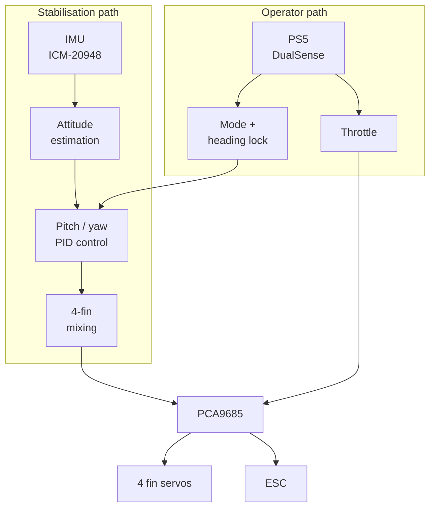
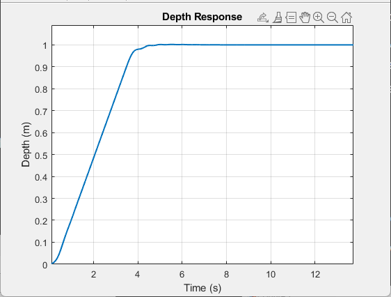
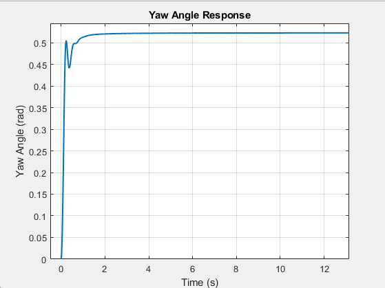

# Underwater Rocket - ESP32 Attitude-Control Firmware (C++)

Embedded C++ firmware (Arduino framework, PlatformIO) for an ESP32-controlled, fin-stabilised underwater vehicle: IMU acquisition and calibration, a 6-axis Mahony attitude filter, pitch/yaw fin control, four-fin servo mixing over a PCA9685, ESC throttle control, Bluetooth (PS5 DualSense) operator control, and over-the-air updates. The repository also contains the MATLAB/Simulink model from the related university graduation project and documents what was and was not demonstrated.

> **Status: prototype / portfolio repository.** No automated tests, no logged flight or pool data, licensed by area under GPL-3.0-or-later / MIT / CC BY 4.0, with one unlicensed third-party dependency (see [Licensing](#licensing)). The firmware has known safety limitations - read [docs/SAFETY.md](docs/SAFETY.md) before running anything with a motor attached.

## What is in here

| Directory | What it is | Status |
|---|---|---|
| [`firmware/graduation_aug26_ps5_heading_hold/`](firmware/graduation_aug26_ps5_heading_hold/) | **Aug 26 2025 graduation-project firmware**: PS5 throttle, heading lock, manual fin control, IMU heading hold | Historical variant, **reconstructed build** ([details](firmware/graduation_aug26_ps5_heading_hold/RECONSTRUCTION.md)). Used in the graduation pool tests. **Not** the competition firmware |
| [`firmware/2025_teknofest_mission/`](firmware/2025_teknofest_mission/) | 2025 TEKNOFEST generation: same estimator/controller lineage plus an 8-state mission machine and roll-safety code | Competition-used *generation*; the exact flashed file is not identified. Compiles |
| [`firmware/2026_wifi_control/`](firmware/2026_wifi_control/) | 2026 stabilise-only firmware with browser control page and link-loss fail-safe | Experimental; the planned autonomous mission was **never completed** |
| [`simulation/graduation_2025/`](simulation/graduation_2025/) | MATLAB/Simulink pitch/yaw/depth model with discrete PID controllers | Simulation only; **not** connected to the firmware |
| [`prototypes/`](prototypes/) | Early WebSocket PID-tuning prototype | Secondary; not compiled in this repo's CI |
| [`docs/`](docs/) | Architecture, safety, development history, graduation project, licensing | |

## Architecture at a glance



The stabilisation path (IMU to fins) is automatic; the operator path (PS5) sets mode, heading lock and throttle. Estimator, signal-path, PS5 command-map, wiring and runtime-task diagrams are in [docs/ARCHITECTURE.md](docs/ARCHITECTURE.md).

### Implemented behaviour (Aug 26 variant)

- **Estimation:** startup still-calibration (500 samples), online gyro-bias adaptation when the vehicle is provably still, 8-sample moving average on gyro-z, hand-written 6-axis Mahony update (standard algorithm; see [docs/LICENSING.md](docs/LICENSING.md) for provenance), quaternion to roll/pitch/yaw. Yaw is gyro-integrated, so the locked heading is relative and drifts.
- **Control:** pitch and yaw controllers built on `PID_v1` (P-only in the preserved configuration), wrapped yaw error, circular yaw filter, deadband, per-fin rate limiting, differential four-fin mixing.
- **Heading lock:** captures the current yaw as the reference, either on a Triangle press or automatically once throttle has stayed above 1200 us for 300 ms; the controller then drives the top/bottom fins differentially to return toward that heading.
- **Operator interface:** PS5 DualSense over Bluetooth - throttle in 100 us steps, Auto/Manual chords, kill button, stick-driven manual fins.
- **Robustness:** I2C bus-clear recovery, IMU soft-reset watchdog, clamped `dt`; OTA update task pinned to core 0.

Parameters of the preserved configuration are listed in [docs/ARCHITECTURE.md](docs/ARCHITECTURE.md#implemented-parameters).

## Physical Testing

https://github.com/user-attachments/assets/aa952f6f-10c2-41a4-87b3-deb6a84ccaf5

*Graduation-project pool test — operator-controlled throttle with IMU-based heading lock. Qualitative demonstration; no onboard telemetry recorded.*

## Code tour

Everything below is in the [Aug 26 variant](firmware/graduation_aug26_ps5_heading_hold/); line numbers refer to the files as committed (the same numbering as the original `main28_08` source).

| Topic | Where to read it |
|---|---|
| IMU acquisition, retry and calibration | [`readIMU_safe`](firmware/graduation_aug26_ps5_heading_hold/src/main.cpp#L142-L153), [`calibrateStill`](firmware/graduation_aug26_ps5_heading_hold/src/main.cpp#L190-L236) |
| Attitude estimation | [`mahony6Update`](firmware/graduation_aug26_ps5_heading_hold/src/main.cpp#L260-L294), [online gyro-bias update](firmware/graduation_aug26_ps5_heading_hold/src/main.cpp#L297-L320), [quaternion to roll/pitch/yaw](firmware/graduation_aug26_ps5_heading_hold/src/main.cpp#L245-L257), [per-loop estimation chain](firmware/graduation_aug26_ps5_heading_hold/src/main.cpp#L515-L560) |
| Heading-lock reference capture | [Triangle request](firmware/graduation_aug26_ps5_heading_hold/src/main.cpp#L470-L474), [capture](firmware/graduation_aug26_ps5_heading_hold/src/main.cpp#L573-L581), [throttle-triggered lock](firmware/graduation_aug26_ps5_heading_hold/src/main.cpp#L583-L599) |
| Pitch/yaw control and fin mixing | [`Servo_Controller::update`](firmware/graduation_aug26_ps5_heading_hold/lib/Servo_Controller/Servo_Controller.cpp#L106-L220), [`manualCombined`](firmware/graduation_aug26_ps5_heading_hold/lib/Servo_Controller/Servo_Controller.cpp#L59-L65), [AUTO-mode call](firmware/graduation_aug26_ps5_heading_hold/src/main.cpp#L601-L606) |
| PS5 input processing | [connection, kill, mode chords, manual fins, D-pad throttle](firmware/graduation_aug26_ps5_heading_hold/src/main.cpp#L427-L512) |
| OTA task and I²C recovery | [`otaTask` (core 0)](firmware/graduation_aug26_ps5_heading_hold/src/main.cpp#L322-L373), [`i2cBusRecover`, `recoverIMU`, watchdog](firmware/graduation_aug26_ps5_heading_hold/src/main.cpp#L118-L167), [PCA9685 wrapper](firmware/graduation_aug26_ps5_heading_hold/lib/Servo_Module/Servo_Module.h#L41-L51) |

### Control law, end to end

1. The IMU yaw is integrated by the Mahony filter (gyro-only, no magnetometer) and smoothed by a **circular** low-pass on sin/cos, so the +/-180 degree wrap does not corrupt the average.
2. **Lock:** when heading lock is requested, the current yaw and pitch become the references. They are relative, not compass bearings.
3. **Error:** `e = wrap180(yaw_ref - yaw_filtered)`. Because `PID_v1` is linear, the wrapped error is fed in with a zero setpoint.
4. **Controller:** a `PID_v1` instance per axis (P-only in the preserved configuration) with output limited to +/-25 degrees about the servo centre.
5. **Conditioning:** deadband, then a per-fin rate limit and a minimum-step write filter before the PCA9685 is updated.
6. **Mixing:** pitch drives the left/right fins oppositely (`90 + u`, `90 - u`); yaw drives the top/bottom fins oppositely, with the sign inverted to match the fin wiring. Roll is not controlled.

Heading-lock capture (`src/main.cpp`, lines 573-581; verbatim apart from removing the common indentation):

```cpp
// Triangle-triggered heading lock
if (triangleLockRequest && !killSwitchEngaged) {
  yawRefDeg = yawDeg;
  servo.setTargetAngles(pitchDeg, yawRefDeg);
  headingLocked = true;
  headingLockT0 = millis();
  triangleLockRequest = false;
  LOGI("Heading LOCKED via Triangle at %.2f deg\n", yawRefDeg);
}
```

Wrapped yaw error and fin mapping (`lib/Servo_Controller/Servo_Controller.cpp`, lines 178 and 194-202, verbatim apart from removing the common indentation; the omitted lines hold the `PID_v1` call and are marked `// ...`):

```cpp
float yawErr = angDiff180f((float)targetYaw, (float)inputYaw);
// ...
double op = applyDeadband(outputPitch, deadbandPitch);
double oy = applyDeadband(outputYaw,   deadbandYaw);
oy = oy * -1.0;   // keep your mechanical inversion

// --- Map to fins, rate limit, maybeWrite(...) exactly as before ---
float tgtL = 90.f + (float)op;
float tgtR = 90.f - (float)op;
float tgtT = 90.f - (float)oy;
float tgtB = 90.f + (float)oy;
```

The second excerpt keeps the original comments, which show its AI-assisted authoring history (see [Attribution](#attribution)).

## Graduation-project evidence (qualitative)

The Aug 26 firmware was used on a physical vehicle in university pool tests. The operator used the PS5 controller for **throttle and heading lock**. In the heading-correction test the vehicle was aligned, heading lock was activated, and the orientation was then deliberately disturbed to observe whether the IMU-based controller would return it toward the locked heading through differential fin actuation.

**What this demonstrates:** the closed-loop heading-hold mechanism exists in the firmware and was exercised on hardware, with qualitative observation of the vehicle's path (camera and stopwatch).

**What it does not demonstrate:** no IMU or fin-command logs were recorded, so there are **no yaw-error, settling-time, overshoot or repeatability figures**, no lock-off baseline, and no claim about performance across speeds. The tests were operator-throttled; the system was **not autonomous**. Details: [docs/GRADUATION_PROJECT.md](docs/GRADUATION_PROJECT.md).

### Simulation (separate from the firmware)

The graduation work also includes a Simulink model with discrete PID controllers for pitch, yaw and depth (via pitch). These are **simulation-only**; the embedded firmware uses different parameters, units, limits and update rate and has no depth loop (the vehicle had no pressure sensor).

| Depth response (sim) | Pitch response (sim) | Yaw response (sim) |
|---|---|---|
|  |  |  |

## Build

Prerequisites: [PlatformIO Core](https://platformio.org/) 6.x and internet access (libraries are fetched; nothing third-party is vendored).

```bash
cd firmware/graduation_aug26_ps5_heading_hold      # or 2025_teknofest_mission / 2026_wifi_control
cp include/secrets.h.example include/secrets.h     # set your own AP/OTA password and PS5 pairing address
pio run -e esp32-usb
```

- Platform (`espressif32@6.6.0`), framework and every library are pinned; the SparkFun IMU driver and the PS5 library are pinned to commit hashes.
- The PS5 library is **fetched at build time and not redistributed here**: it has **no confirmed licence**. Do not vendor it or distribute compiled firmware built from the PS5-dependent variants ([docs/PS5_DEPENDENCY.md](docs/PS5_DEPENDENCY.md)).
- GitHub Actions compiles all three firmware variants and runs `reuse lint` on every push ([.github/workflows/build.yml](.github/workflows/build.yml)); these checks have passed on GitHub. Compilation verifies buildability, not hardware behaviour; **nothing here has been re-run on hardware from this repository.**
- On Windows keep the checkout path short; the SparkFun library can exceed the 260-character path limit.
- OTA upload: set `UWR_OTA_PASSWORD` in your environment and use `-e esp32-ota`.
- Real credentials and the controller pairing address live only in the git-ignored `include/secrets.h`. They were removed from the historical sources; see [RECONSTRUCTION.md](firmware/graduation_aug26_ps5_heading_hold/RECONSTRUCTION.md) for the exact (two-line) sanitisation.

## Known limitations (summary)

Verified in the source; full list in [docs/SAFETY.md](docs/SAFETY.md):

1. After the PS5 kill button is pressed the **ESC keeps receiving the last throttle command** (only the fins are neutralised).
2. **No Bluetooth link-loss failsafe** in the Aug 26 variant: on disconnect throttle and automatic fin control continue unchanged. (Only the experimental 2026 firmware has a link-loss timeout.)
3. Yaw is gyro-only and drifts; no magnetometer correction.
4. A failed IMU read skips the control cycle without neutralising fins or throttle.
5. No tests, no logging to flash/SD, and no authenticated control channel.

The historical code is preserved as written; these issues are documented, not silently fixed.

## Development history

The original sources had no version control, only dated file snapshots. [docs/DEVELOPMENT_HISTORY.md](docs/DEVELOPMENT_HISTORY.md) reconstructs the Aug 2025 - Jun 2026 evolution from file dates (not commit dates) and shows where the PS5 manual-control line ends and the mission state machine begins.

## Attribution

- Firmware (estimation, control wrapper, PS5/OTA/mission logic, web interface): the repository author, **developed with AI assistance**.
- MATLAB/Simulink modelling and simulation: the repository author.
- Mechanical design of the vehicle: a teammate from the TEKNOFEST 2025 team (not the repository author). The graduation report, manufacturing and testing were team work.
- Third-party components and algorithms are credited in [THIRD_PARTY.md](THIRD_PARTY.md). The Mahony algorithm is by Mahony, Hamel and Pflimlin (IEEE TAC 2008); it is not an original contribution.

## Licensing

| Area | Licence |
|---|---|
| Firmware, prototypes, tools, CI (`firmware/`, `prototypes/`, `tools/`, `.github/`) | [GPL-3.0-or-later](LICENSES/GPL-3.0-or-later.txt) |
| Simulink model and MATLAB scripts (`simulation/`) | [MIT](LICENSES/MIT.txt) |
| Documentation, diagrams and figures (README, `docs/`, all Markdown, figures, pool-test clip in `media/`) | [CC BY 4.0](LICENSES/CC-BY-4.0.txt) |

The mapping is machine-readable in [`REUSE.toml`](REUSE.toml) and passes `reuse lint`. These licences cover **only the author's original material**. [`NOTICE`](NOTICE) and [docs/LICENSE_SCOPE.md](docs/LICENSE_SCOPE.md) clarify the exclusions, including fetched libraries, the Mahony algorithm and its reference code, MATLAB/Simulink software, the teammate's mechanical design, and the unpublished report and other excluded media. The included pool-test video is licensed as stated above; that licence does not cover the vehicle's mechanical design.

**The PS5 library has no confirmed licence.** The 2025 mission and Aug 26 variants depend on a third-party library with no licence file. It is fetched from a pinned upstream commit and is not redistributed here. **Choosing the GPL does not license it or resolve its status.** Do not vendor or mirror it, and do not distribute compiled firmware (`.bin`/`.elf`) built from those variants. Permission has not been requested or obtained. Details: [docs/PS5_DEPENDENCY.md](docs/PS5_DEPENDENCY.md).

The licence choice for the firmware follows the open provenance question on the Mahony update function, explained in [docs/LICENSING.md](docs/LICENSING.md).
