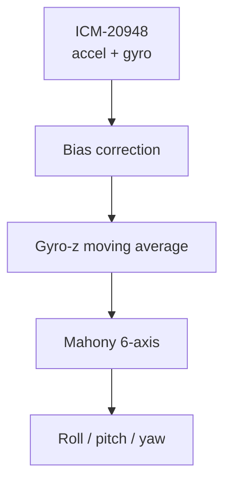
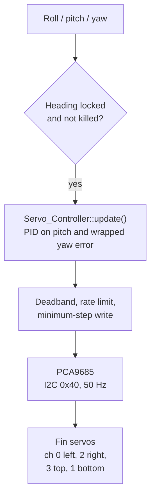
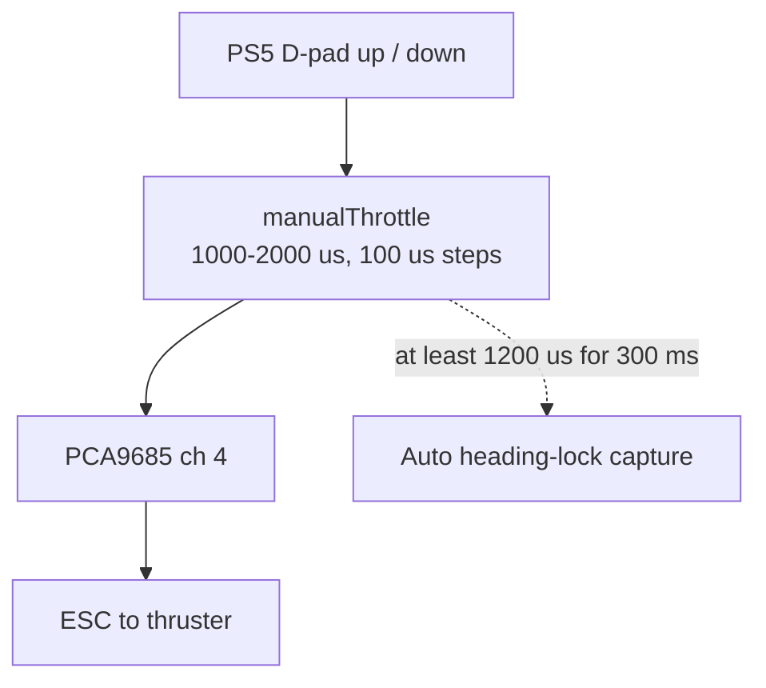
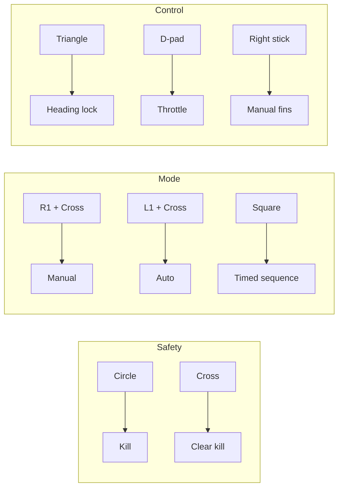
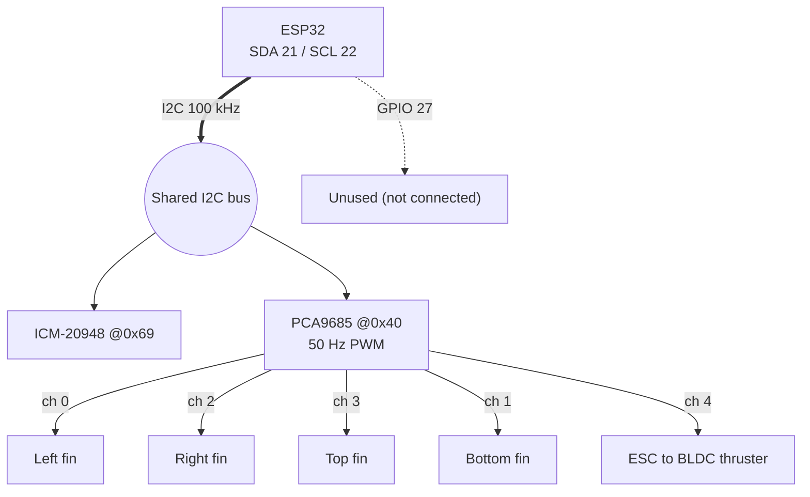
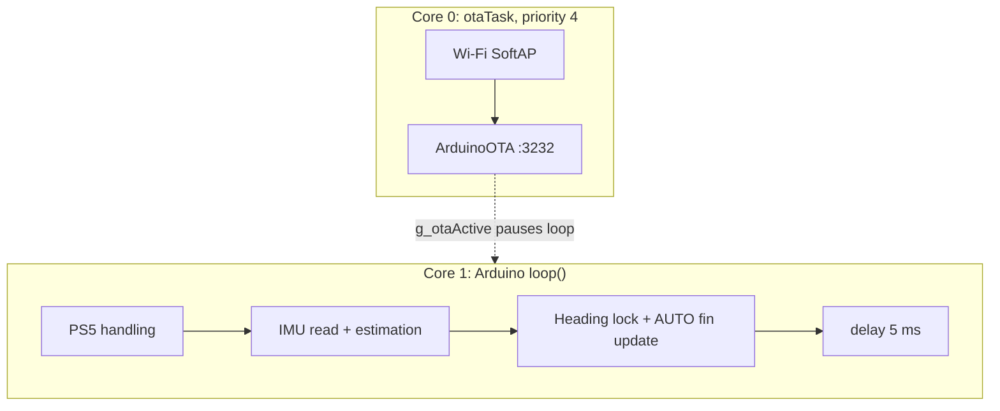

# Architecture (Aug 26 2025 graduation-project variant)

All statements are from the firmware source unless marked otherwise. Line numbers refer to [`firmware/graduation_aug26_ps5_heading_hold/src/main.cpp`](../firmware/graduation_aug26_ps5_heading_hold/src/main.cpp), which differs from the original file only in two sanitised credential lines. The supporting classes are a **reconstruction** (see [RECONSTRUCTION.md](../firmware/graduation_aug26_ps5_heading_hold/RECONSTRUCTION.md)), so gains and library-level behaviour are provisional.

## 1. Signal paths

The vehicle has two independent signal paths that meet only at the PCA9685: an automatic **stabilisation path** (IMU to fins) and an **operator-throttle path** (PS5 to ESC). Heading-lock logic is the one place where the operator influences stabilisation.

### 1a. Estimation (core 1, ~200 Hz target)

- **IMU:** ICM-20948 at I2C address 0x69, 100 kHz, shared bus; the magnetometer is unused, so yaw is gyro-integrated and drifts.
- **Bias correction:** startup mean (500 samples) plus the online adaptation (ZARU) when the vehicle is provably still.
- **Moving average:** 8 samples, gyro z only.
- **Mahony update:** Kp 0.5, Ki 0. The quaternion is converted to roll/pitch/yaw in degrees.

### 1b. Stabilisation: control to fins

- `Servo_Controller::update()` applies a pitch EMA and a circular yaw filter, then computes the wrapped yaw error and feeds both axes to `PID_v1`.
- Conditioning is deadband, then a per-fin rate limit, then a minimum-step write filter before the PCA9685 is updated.
- Every step is in `loop()` (lines 423-623) except `Servo_Controller`, which is in `lib/`.

### 1c. Operator throttle

- Throttle is written to the ESC every loop regardless of kill state (lines 501-502); see [SAFETY.md](SAFETY.md).
- Throttle at or above 1200 us for 300 ms captures the current yaw as the heading reference; falling below 1200 us unlocks (lines 583-599).

## 2. PS5 command map

| Input | Action | Lines in `main.cpp` |
|---|---|---|
| Circle | **Kill:** fins to 90 deg, heading lock dropped | 438-444 |
| Cross | Clear kill | 445-448 |
| R1 + Cross | MANUAL mode | 451-453 |
| L1 + Cross | AUTO mode | 454-456 |
| Square (manual mode) | Blocking timed sequence | 458-467 |
| Triangle | Heading-lock request | 470-474, 573-581 |
| D-pad up / down | `manualThrottle` +/-100 us, range 1000-2000 | 485-499 |
| Right stick X / Y | Manual fins: pitch +/-30 deg, yaw +/-20 deg | 477-483 |

Notes: Cross is part of both the kill-clear and the mode chords. Throttle is written to the ESC every loop regardless of kill state (lines 501-502). Automatic heading lock: throttle >= 1200 us for 300 ms captures the current yaw (583-599) and unlocks when throttle falls below 1200 us.

## 3. Actuator mapping and the physical ESC connection

- GPIO 27 also carries an LEDC throttle signal, but **nothing was connected to it on the vehicle**.

- The ESC signal wire was connected to **PCA9685 channel 4** (author-confirmed). In code this is `Servo_Module esc(4)` (line 96), written at lines 349, 417, 464-466 and 502.
- `Motor_Module motor(27)` also drives GPIO 27 (lines 95, 348, 501), but nothing was attached there; `motor.armESC()` therefore arms an unused pin, and the real ESC first receives a 1000 us pulse at line 417.
- Mixing: left/right fins are driven oppositely for pitch (`90 + p` / `90 - p`), top/bottom oppositely for yaw. There is no roll control (`manualCombined`'s roll argument is unused).
- Power architecture (report figure, not firmware): pack voltage to the ESC, a 5 V rail to the ESP32 and a regulated servo rail via a DC-DC converter; a hardware emergency-stop button is listed in the report's bill of materials. What it disconnects is not documented.

## 4. Runtime tasks

While OTA is active the loop is paused and outputs are forced to idle/neutral on OTA start.

Startup order: OTA task, a 5 s window, IMU init (10 retries), 500-sample calibration, servo/ESC init, PS5 begin.

## Implemented parameters

These are the values in the preserved/reconstructed configuration, listed for reference.

| Item | Value | Source |
|---|---|---|
| Mahony | Kp 0.5, Ki 0 | `main.cpp:68-69` |
| IMU I2C | 100 kHz, `Wire` timeout 50 ms | `main.cpp:43, 180` |
| Calibration | 500 samples at 5 ms | `main.cpp:49-50` |
| Online bias (ZARU) | gyro < 0.2 deg/s, |a| within 0.03 g of 1 g, 10 s time constant | `main.cpp:86-91` |
| `dt` clamp | 0.5 to 20 ms | `main.cpp:533` |
| Pitch / yaw controller | Kp 1.5, Ki 0, Kd 0 each (`PID_v1`) | `lib/Servo_Controller` (reconstruction) |
| Controller output limit | +/-25 deg about 90 deg | `lib/Servo_Controller` |
| Filters | pitch EMA 0.10; yaw circular low-pass 0.18 | `lib/Servo_Controller` |
| Deadband | 2 deg pitch, 6 deg yaw | `lib/Servo_Controller` |
| Rate limit | 180 deg/s pitch fins, 120 deg/s yaw fins | `lib/Servo_Controller` |
| PID compute interval | library default (100 ms); the reconstruction does not set it | `PID_v1` default |
| Manual fins | pitch +/-30 deg, yaw +/-20 deg, no stick deadband | `main.cpp:240, 479-480` |
| Throttle | 1000-2000 us, 100 us steps | `main.cpp:485-499` |
| Heading lock (auto) | throttle >= 1200 us for 300 ms | `main.cpp:104-105, 583-599` |
| Fin servo pulse range | 500-2500 us over 0-180 deg | `Servo_Module.h` |

The Simulink model uses different controllers and units; see [simulation/graduation_2025/README.md](../simulation/graduation_2025/README.md).
