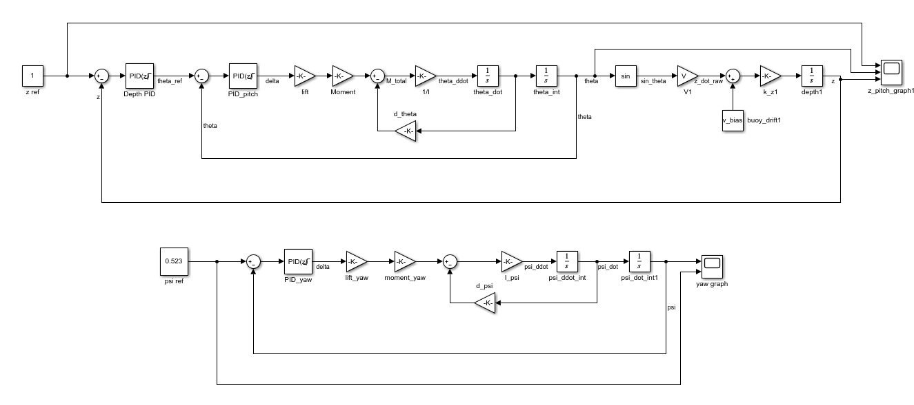
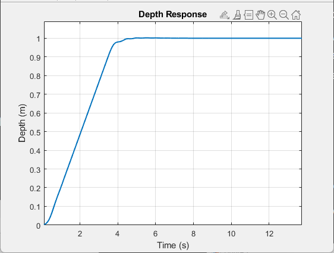
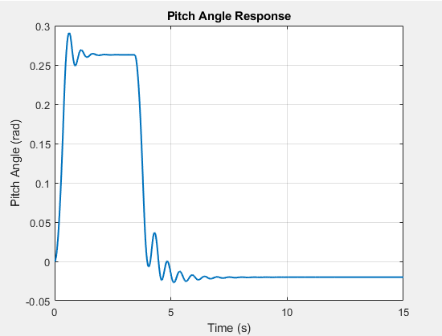
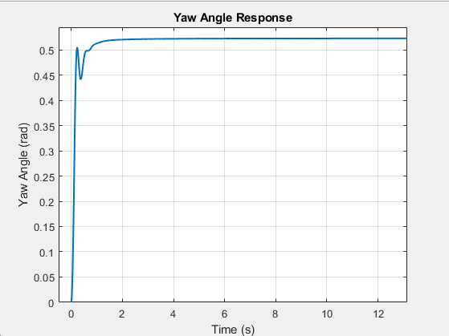

# Graduation-project Simulink model (simulation only)

Reduced-order model of the fin-controlled vehicle's **pitch, yaw and depth** dynamics with discrete-time PID controllers, written in MATLAB/Simulink (saved with R2020b). Author: the repository author. This directory is **simulation only**: the embedded firmware does not use these controllers (see the comparison below).

| File | Purpose |
|---|---|
| `dynamic_simulation.slx` | Simulink model: cascaded depth-to-pitch controller and a yaw controller driving fin deflection; reduced-order rigid-body dynamics |
| `main.m` | Defines the model parameters, runs `sim('dynamic_simulation')`, and evaluates the logged `z`, `theta` and `psi` signals with `stepinfo` and plots |
| `rocket_pitch_dynamics.m` | Earlier pitch-only ODE prototype (Nov 2025) kept for reference; not used by the Simulink model |
| `figures/` | The model screenshot and the three response plots (MATLAB output) |

Open `main.m` in MATLAB with Simulink and run it; it loads the parameters and executes the model. (MATLAB was not run while preparing this repository, so no numerical results are quoted here beyond what the figures show.)

## Model and parameters

From `main.m` (graduation configuration) and the saved model:

| Quantity | Value |
|---|---|
| Fluid density | 1000 kg/m^3 |
| Forward speed (assumed constant) | 1.5 m/s |
| Vehicle mass | 18 kg |
| Fin area / lift-curve slope / moment arm | 0.004 m^2 / 6.28 per rad / 0.45 m |
| Pitch / yaw inertia | 2.83 / 0.165 kg m^2 |
| Rotational damping (pitch / yaw) | 5 / 1.5 |
| Vertical drag factor, buoyancy-drift constant | 0.5, 0.03 |
| Yaw reference | 0.523 rad (about 30 deg) |

Structure (from the model's blocks): fin lift = 0.5 * rho * V^2 * S * CL_alpha * deflection, pitch/yaw moments from two fins at the moment arm, divided by inertia and integrated twice with damping; depth rate from forward speed times the sine of pitch, divided by one plus the vertical-drag factor, plus a constant buoyancy drift.

Controllers in the model (discrete parallel PID with filtered derivative, output saturated at +/-0.35 rad):

| Controller | P | I | D | Filter N | Sample time |
|---|---|---|---|---|---|
| Pitch (inner loop) | 10 | 0 | 1 | 10 | 0.005 s |
| Yaw | 1 | 0.5 | 0.14 | 10 | 0.005 s |
| Depth (generates the pitch reference) | 3 | 2 | 0 | 10 | 0.05 s |

| Depth response | Pitch response | Yaw response |
|---|---|---|
|  |  |  |

## Simulation versus the embedded firmware

| | Simulink model | Aug 26 firmware (reconstructed) |
|---|---|---|
| Angle units | radians | degrees |
| Pitch / yaw controller | PID 10/0/1 and 1/0.5/0.14 | P-only, Kp 1.5 each |
| Output limit | +/-0.35 rad (~20 deg) | +/-25 deg |
| Controller sample time | 5 ms | ~10 Hz effective (library default, 100 ms) |
| Depth loop | yes (pitch-kinematics model) | none; the vehicle had no pressure sensor |
| Speed | constant 1.5 m/s assumed | operator throttle |

No document shows the simulated controllers were deployed on the vehicle. The depth response is a model-based evaluation of pitch-induced vertical motion, not a hardware depth controller. The model file's metadata carries the author's name as creator.

A later (June 2026) model for a different project exists in the author's archive and is deliberately not included.
